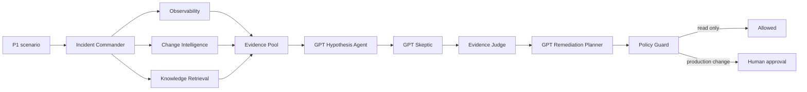

# Flight Control

[](https://github.com/muhanye194-afk/flight-control/actions/workflows/ci.yml)

[](LICENSE)

An evidence-first incident response workspace for investigating simulated P1 outages with specialist agents, structured GPT analysis, deterministic scoring, and human approval gates.

Flight Control is designed as a reliability engineering portfolio project—not a general-purpose chatbot. It separates observed evidence from generated hypotheses and never executes production-changing actions automatically.

## What it demonstrates

- Three incident scenarios covering payments, video edge routing, and feed caching.
- Parallel specialist review of metrics, logs, traces, recent changes, and runbooks.
- Domain-scoped hybrid retrieval so unrelated operational knowledge does not leak between scenarios.
- GPT-5.6 structured outputs for competing hypotheses, skeptical review, and remediation planning.
- A deterministic Evidence Judge that scores source quality, diversity, reliability, and counter-evidence.
- A Policy Guard that blocks unsafe actions and routes high-risk changes to named human approval.
- A responsive dashboard with both live GPT analysis and a no-cost offline demo.

## Engineering decisions

- **The model proposes; code decides.** GPT generates hypotheses, challenges, and remediation candidates, while a deterministic judge and policy layer make the final routing decisions.
- **Every claim points back to evidence.** Structured outputs must reference evidence IDs already collected by specialist agents; unknown IDs are rejected instead of silently accepted.
- **Live and deterministic paths stay separate.** The live path demonstrates model reasoning, while the offline path keeps interviews, development, and CI repeatable without API spend.
- **Production changes stop at an approval boundary.** The demo records a named approval but never connects to production infrastructure or executes a proposed change.

## Decision flow



## Run locally

Requires Python 3.9 or newer.

```bash
git clone https://github.com/muhanye194-afk/flight-control.git
cd flight-control
python3 -m venv .venv
source .venv/bin/activate
pip install -r requirements.txt
cp .env.example .env
```

Add an OpenAI API key to `.env` for live analysis:

```dotenv
OPENAI_API_KEY=your_openai_api_key_here
OPENAI_MODEL=gpt-5.6-sol
OPENAI_TIMEOUT_SECONDS=90
OPENAI_MAX_RETRIES=2
```

Start the API and dashboard:

```bash
python -m uvicorn main:app --reload --port 8001
```

Then open [http://127.0.0.1:8001/dashboard/](http://127.0.0.1:8001/dashboard/).

- **Run GPT analysis** makes live API calls and uses paid API credits.
- **Run offline demo** exercises the complete evidence, scoring, policy, and approval flow without an API call.

The `.env` file is ignored by Git. Never commit or paste an API key into source code.

## Tests

The regression suite is intentionally runnable without `pytest` or an OpenAI key:

```bash
python tests/run_all.py
```

It covers specialist agents, evidence scoring, policy enforcement, run storage, deterministic embeddings, the offline decision flow, and API smoke checks. GitHub Actions runs the same suite on every push and pull request.

## API highlights

| Method | Endpoint | Purpose |
| --- | --- | --- |
| `GET` | `/api/scenarios` | List scenarios and the active selection |
| `POST` | `/api/scenarios/{id}/activate` | Switch the active local scenario |
| `POST` | `/api/investigations/active/run` | Run the live GPT investigation |
| `POST` | `/api/demo/active-decision` | Run the deterministic offline demo |
| `POST` | `/api/investigations/{run_id}/approve` | Record a named human approval |
| `GET` | `/docs` | OpenAPI documentation |

## Safety boundaries

This repository uses simulated incidents and local scenario data. Generated remediation remains advisory. The Policy Guard can allow read-only observation, require approval for risky changes, or block unsafe proposals; it does not connect to or mutate production infrastructure.

## Current scope and trade-offs

This is a portfolio prototype with production-inspired boundaries, not a deployed incident-management service. Investigation runs and approvals are stored in memory, the API has no user authentication, and the scenarios use local fixtures rather than live telemetry. A production version would add durable storage, role-based access, secrets management, observability, model evaluations, and integrations with incident and deployment systems.

## Project structure

```text
agent/            specialist agents, judge, policy guard, and orchestration
dashboard/        dependency-free dashboard
knowledge_base/   runbooks, architecture notes, and postmortems
rag/              hybrid retrieval pipeline
scenarios/        isolated incident fixtures
tests/            regression and API smoke tests
main.py           FastAPI application
```

Built with FastAPI, Pydantic, the OpenAI Responses API, BM25, sentence-transformers, and vanilla HTML/CSS/JavaScript.
